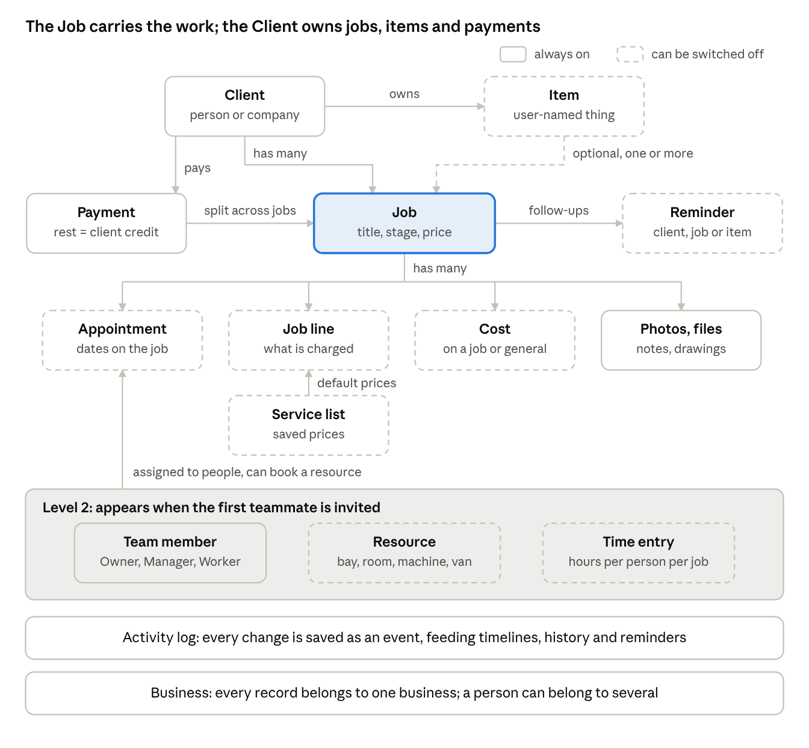

# Онова за клиентите — Product Design (v1.0)

Oct 6, 2026 · @Tsvetomir Tsekov

> Snapshot of the living design doc, exported 6 Oct 2026: https://claude.ai/code/artifact/c79d23dc-33e3-4bdc-baf2-424f77aac969

## Overview

Онова за клиентите is a simple app for any small service business to manage clients, jobs and money. It serves one solo provider (Level 1) or a small team (Level 2), Bulgaria first. The core structure is fixed; each business customizes the words, visible modules, extra fields and job stages.

**Design principles**

- **Simple first.** One main action per screen, smart defaults, details behind "more". Lists of things to act on, not chart dashboards.
- **Profession-neutral.** No trade presets and no "what's your profession" question. Setup asks how people work, not what they do.
- **Fixed structure, flexible vocabulary.** Users rename, hide, extend and re-stage, but never change how the building blocks connect.
- **Grows with the business.** Level 2 appears when the first teammate is invited. No migration, no second product.
- **In-house management.** The app tracks money but issues no legal documents.
- **Staff-only v1, customer-ready data.** Customer-facing features switch on later without reworking the data.
- **Bulgaria first.** Bulgarian UI, EUR, Viber, data hosted in the EU.

## Decisions so far

Twenty-six decisions came out of the 6 Oct 2026 brainstorm, pressure test, final questions and the first two prototypes. Everything below builds on them.

| Area | Decision | Why |
| --- | --- | --- |
| Market | Bulgaria first | Bulgarian language, Viber and EUR are gaps the US tools (Jobber, Housecall Pro) leave open |
| Positioning | Profession-neutral core that users customize | Widest audience. Trade examples are only for checking the design |
| Core object | The Job, not a single visit | The first user (a furniture maker) works in orders that run for weeks |
| Customization | One settings page plus a step-by-step setup wizard | Users never face all the controls at once |
| Money | In-house management only, at both levels | Small scope. Avoids Bulgarian invoicing and e-invoicing rules |
| Currency | EUR only, no BGN | Bulgaria has used the euro since 1 Jan 2026 |
| Platform | PWA (installable web app) | One codebase. Android dominates in Bulgaria. Level 2 needs desktop web anyway |
| Customers | Staff-only v1, with customer-ready data structures | Customer features later without reworking the data |
| First user | Level 1: a furniture maker (the founder's friend) | Real usage before selling Level 2 to teams |
| Payments | Payments belong to the client and are split across jobs; any rest is client credit | Handles prepayments and one transfer for several jobs |
| Recurring work | "Repeat" creates the next job on a schedule | Each visit keeps its own price and payment |
| Job stages | One stage list per business; stages can be skipped | Simple for v1. Job types only if real users ask |
| Walk-ins | A built-in "No client" record | Every job and payment still has an owner |
| General costs | Costs can be general (rent, fuel, tools), not only per job | Monthly profit stays honest |
| Offline | View offline, edit online | No signal on site still shows today's jobs and client details, without a local-first sync layer |
| Due date | Optional due date on a Job, separate from appointments | The promised date drives "overdue" for any trade |
| Job summary | Shareable image/PDF of a job in v1, labelled "not an invoice" | Clients ask for a written offer; Viber is how it reaches them |
| СУПТО | Written accountant answer before public launch | Testing with the first user can start now; the risk is settled before anyone else uses it |
| Pricing | Free Level 1 with limits, then a paid Level 1; Level 2 is paid only | Free entry grows usage; teams pay from the start |
| Owner notifications | Push notifications | Morning summary, reminders and overdue jobs without opening the app |
| Sign-in | Google or an email code, likely through Clerk | No passwords, no per-login cost |
| Language | Bulgarian only, with all text in translation files | Other languages can be added later without rework |
| Name | Онова за клиентите | Fits the founder's "онова за" label family |
| First-user interview | Real interview skipped; the simulated answers stand as working assumptions | Throwaway prototypes test the assumptions faster than talking about them |
| Setup wizard format | Live preview: the Job form stays on screen and changes with each answer | Founder's pick in prototype 1. Each answer shows its effect straight away |
| New job entry | One line, typed like a notebook, read back as fields before saving | Founder's pick in prototype 2. Closest to the notebook it replaces |

## Core data model

Twelve fixed building blocks, all inside one Business, cover every service business. Users can rename them and switch some off, but never change how they connect.

Dashed boxes are modules a business can switch off. The shaded band only exists once a business has a team.

| Block | What it is | Key data | Level | Can be switched off |
| --- | --- | --- | --- | --- |
| Business | The workspace that owns all data | Name, logo, contacts, settings. A person can belong to several | 1 | No |
| Client | A person or company the business serves | Name, phones, email, address, note; person or company. A built-in "No client" record covers walk-ins | 1 | No |
| Job | One piece of work for a client | Title, stage, price, due date (optional), address (defaults to the client's), notes, photos and files. Can repeat on a schedule | 1 | No |
| Job line | One charged line on a job | Description, quantity, unit price; often picked from the service list | 1 | Yes |
| Appointment | A date or time slot, usually on a job | Start, end or all-day, label (e.g. "Measuring"). In Level 2 it may have no job (blocked time) | 1 | Yes |
| Payment | Money received from a client, split across one or more of their jobs | Amount (negative for a refund), date, method, amount allocated to each job, label (e.g. "Deposit") | 1 | No |
| Cost | Money spent on a job, or general (rent, fuel, tools) | Amount, date, label (materials, parts, transport) | 1 | Yes |
| Item | A thing the client owns that the work is done on | User-named (car, device, property, animal) plus its extra fields. Can move to another client with its history | 1 | Yes, off by default |
| Reminder | A follow-up date with a note | Date, note, linked client, job or item | 1 | Yes |
| Service list entry | A saved service or product | Name, default price; default duration in Level 2 | 1 | Yes |
| Team member | A user in the business | Name, role (Owner, Manager or Worker). Deactivated, never deleted | 2 | No |
| Resource | Something bookable that isn't a person | Name (bay, room, machine, van) | 2 | Yes |
| Time entry | Work time on a job | Person, job, start, end | 2 | Yes |

**How they connect**

- A Business holds everything else. A person can belong to several businesses and switch between them.
- A Client has many Jobs, Items, Payments and Reminders.
- A Job belongs to one Client and can link to one or more of that client's Items. It has many Job lines, Appointments, Costs, photos and files. A Payment belongs to the Client and is split across one or more of that client's Jobs; any unallocated rest is client credit. A Cost belongs to a Job, or to the Business as a general cost. A repeating Job creates its next Job on a schedule.
- In Level 2, Jobs and Appointments can have several assignees, and Appointments can book a Resource.

**Calculated, never typed**

- Price = sum of job lines, or typed when the job has no lines.
- Balance = price − payments allocated to the job. Client credit = a client's payments − the amounts allocated to jobs.
- Job profit = payments allocated to the job − its costs. Monthly profit = payments received − all costs, general ones included.
- Flags such as "overdue", "unpaid" and "reminder due" are computed from dates, stages and balances.

**Activity log.** Every change is saved as an event (job created, stage changed, payment added). It feeds the client and job timeline in Level 1, change history in Level 2, and later the reminders and customer messages.

## Customization

Users change words, visibility, extra fields and job stages, never structure. That limit is what keeps the core solid and the screens simple.

| What | What the user does | Example | Level |
| --- | --- | --- | --- |
| Names | Rename Client, Job, Item, Appointment (singular and plural) | Job → "Ремонт" | 1 |
| Modules | Switch Appointments, Costs, Items, Reminders, Service list on or off | A tutor switches Costs off | 1 |
| Job stages | Name and order their own stages; each belongs to one stage group, and the group sets its colour (D53) | "Чака части" in the *In progress* group | 1 |
| Extra fields | Add fields to Client, Job or Item | Item field "Plate number" | 1 |
| Service list | Saved services and default prices | "Монтаж – €40" | 1 |
| Reminder rule | When a job is done, suggest a reminder in N months | 12 months | 1 |
| Team modules | Switch Resources and Time tracking on or off | A shop books its 3 bays | 2 |

**Stage groups.** Every user-defined stage belongs to one of four fixed groups: *New*, *In progress*, *Done*, *Cancelled*. The Today list, "who owes me" and reports read the groups, so they work whatever the stages are called. Each business has one stage list, and a job can skip stages or move back.

**Extra fields.** Eight types only: text, long text, number, money, date, yes/no, choice, photo. Each field has a "show in list" toggle. Forms carry a small "+ field" link, so fields can be added where the need appears.

**Safe changes.** Customizing never destroys data:

- Fields that hold data are archived, not deleted. Restoring brings the data back.
- Choice options are stored by id, so renaming an option updates every record.
- A field's type can change only between text and long text. Anything else is a new field.
- A stage with jobs in it can't be deleted until its jobs move. New, In progress and Done each keep at least one stage.
- Switching a module off hides it and its data, never deletes them. Profit is hidden while Costs is off.

**Names and Bulgarian grammar.** Renaming breaks gendered words: "Нова поръчка" becomes "Нова ремонт". The UI avoids gendered adjectives ("+ Поръчка", "Добави ремонт"), or the rename field also asks for the word's gender. Numbers never go before a renamable noun, because masculine nouns need a count form ("5 ремонта", not "5 ремонти"). Counts read "Ремонти: 5".

**Not customizable, on purpose**

- New kinds of building blocks or links between them
- Formulas and calculated fields
- Automation rules beyond the single reminder rule
- Screen layouts

These are where flexible tools such as Airtable or Salesforce become hard to use.

## Setup wizard

An 8-step wizard asks how people work, never what their profession is, and turns each answer into settings. The Job form stays on screen above the questions and changes with each answer, so people see what every answer does. Questions come one at a time and every step is skippable. Prototype 1 picked this over one question per screen and a chat.

| Step | Question | What it sets |
| --- | --- | --- |
| 1 | Business name and logo (optional) | Profile, used later on anything clients see |
| 2 | "What do you call the work you do for a client?" Choices: Поръчка, Задача, Проект, Посещение, Ремонт, or their own word | Job name |
| 3 | "How does a typical job go?" *One visit and done* or *Several steps over days or weeks* | Starting stages; one or several appointments per job |
| 4 | "Do you work on something the client owns?" If yes: "What do you call it?" plus 2–3 suggested fields | Item module, its name and fields |
| 5 | "Do you take deposits or prepayments?" and "Do you want to track costs?" | How prominent partial payments and client credit are; Costs module (job and general costs) |
| 6 | "Do clients come back regularly?" Choices: on a fixed schedule (e.g. weekly), every few months, no | Fixed schedule: new jobs repeat by default. Every few months: reminders and the reminder rule |
| 7 | "Your 3–5 most common services and prices" | Service list |
| 8 | "Import clients from your phone or Excel" | Starting data |
| Done | The finished Job form with "Is this how you work?" and "change" links | — |

**Rules**

- Every answer has a sensible default, so skipping all steps still gives a working app.
- Settings can re-run the wizard, and everything it sets stays editable by hand.
- "Just you or a team?" is not asked. Level 2 starts when the owner invites the first teammate, which opens a short team wizard: roles, who gets assigned work, and bookable resources.

## Settings page

One settings page with short, separate sections. Nothing on it is required to start using the app.

| Section | Contains | Level |
| --- | --- | --- |
| Business | Name, logo, contact details | 1 |
| Names | Renaming Client, Job, Item, Appointment | 1 |
| Modules | On/off switches for optional building blocks | 1 |
| Job stages | Stage names, order, stage groups | 1 |
| Fields | Extra fields, in tabs for Clients, Jobs, Items | 1 |
| Services & prices | The service list | 1 |
| Reminders | The reminder rule and its interval | 1 |
| Team | Members, roles, resources | 2 |
| Data | Import, export, delete account and data | 1 |
| Run setup again | Re-opens the wizard with current answers filled in | 1 |

## Money

Money is tracked for in-house management only. The app issues no invoices, receipts or any document that looks like one.

**Per job**

- Price from job lines, or typed when there are none. Any number of payments and costs.
- Balance and profit are calculated (see Core data model).
- Payment method is a fixed list: cash, bank transfer, card, other.
- A refund is a negative payment. "Write off balance" closes an unpaid remainder with a note.
- A payment belongs to the client and is split across their jobs. Paying from a job allocates it to that job automatically; any rest is kept as client credit.

**Money screen**

- Received this month
- Total still owed, with the "who owes me" list
- Client credit held (paid in advance, not yet used)
- Costs this month, job and general (rent, fuel, tools)
- Profit this month, after all costs

**Job summary.** One tap makes an image or PDF of the job: lines, price, deposit and balance, labelled "not an invoice". It is shared through Viber or any other app, with no client account needed.

## Customer-ready structure

Six data structures go in from v1 but stay hidden. Each future customer feature then becomes a switch to turn on, not a database change.

| Structure | What it stores | Future use |
| --- | --- | --- |
| Contact details | Phones in international format (+359…), email, preferred channel (phone, Viber, SMS, email) | Reaching clients the way they prefer |
| Consent | Separate yes/no for service messages and marketing, each with the date given | GDPR-compliant reminders and campaigns |
| Share links | Random, unguessable link; target (job or client); permission (*view*, *approve*, *book*); expiry; cancelled date | Status page, quote approval and booking, all without client accounts |
| "Visible to client" flags | A flag on fields, photos and stages; an optional client-facing name per stage | Internal "Чака части" shows the client "В процес" |
| Messages log | Channel, recipient, template, delivery status, related job | v1 records manual "contacted via Viber"; Level 2 sends automatic reminders through it |
| Job source | Manual, phone, online | Online requests later land in the *New* stage group |

## Level 1 and Level 2

Level 1 serves one person on a phone. Level 2 adds what changes when several people share the work; it switches on when the first teammate is invited, with nothing to migrate.

| Area | Level 1 (solo) | Level 2 (team) |
| --- | --- | --- |
| Main screens | Today, Jobs, Clients, Money, plus one "+" button | Adds Calendar and Team |
| Clients and jobs | All core blocks, stages, extra fields, repeating jobs | Same |
| Planning | Appointments on jobs; Today and Upcoming lists | Calendar by person and by resource; drag to reschedule; conflict warning |
| People | One user | Roles: Owner (everything), Manager (no business settings), Worker (own jobs only; can record payments but sees no totals) |
| Work | — | Assign jobs and appointments to one or more people; blocked time; time tracking per job; deactivate leavers and reassign their jobs |
| Client contact | Call and Viber buttons; manual "contacted" log; shareable job summary | Automatic reminders by Viber, SMS or email |
| Money | Per-job money and the Money screen | Adds revenue and hours per person |
| History | Job and client timeline | Visible change history: who changed what and when |
| Search | Everything in one box, Latin and Cyrillic | Same |
| Data | Import from phone or Excel (unknown columns become extra fields); export anytime; merge duplicate clients; anonymize a client on request | Same |
| Notifications | Push to the owner: morning summary, reminders due, overdue jobs | Same, for each person's own jobs |

Level 1 is designed phone-first. Level 2 must also work well on a desktop, for the person running the schedule.

**Plans.** Level 1 starts free; Level 2 is paid only. Prices are not set yet.

| Plan | For | Includes |
| --- | --- | --- |
| Free | Solo users getting started | All of Level 1, within limits |
| Solo (paid) | Solo users past the free limits | All of Level 1, no limits |
| Team (paid only) | Businesses with a team | Level 2, per business |

The free limits get set with the first users. Candidates: number of active jobs or clients, and photo storage.

## Genericity check

Six unrelated businesses fit the same core through the wizard alone, with no profession-specific code. These are test cases, not presets.

| Business | Job called | Item | Modules on | Typical stages |
| --- | --- | --- | --- | --- |
| Furniture maker | Поръчка | — | Appointments, Costs | Оглед → Изработка → Монтаж → Готово |
| Car repair shop | Ремонт | Автомобил (plate, mileage) | Items, Costs, Reminders | Приет → В ремонт → Чака части → Готов |
| AC technician | Посещение | Климатик (model, location) | Items, Reminders | Насрочено → Изпълнено |
| Mobile dog groomer | Посещение | Куче (breed, temperament) | Items, Reminders | Насрочено → Готово |
| Tutor | Урок | — | Appointments | Насрочен → Проведен |
| Office cleaner | Почистване (repeats weekly) | — | Appointments | Насрочено → Готово |

**The test for every new kind of business:** if it fits through the wizard and settings alone, the core holds. If it needs new code, either the core is missing something or the request is outside the limits on purpose.

## Platform and Bulgaria specifics

The app ships as a PWA hosted in the EU, built for how Bulgarian small businesses already work: on Android, on Viber, in Cyrillic and Latin.

| Topic | Decision or fact | Consequence |
| --- | --- | --- |
| PWA | Android was 77.6% of mobile in Bulgaria in Sept 2026 ([Statcounter](https://gs.statcounter.com/os-market-share/mobile/bulgaria)) | Android PWAs get install prompts, notifications and offline support |
| iOS | Apple kept Home Screen web apps in the EU after its 2024 reversal ([Notificare](https://notificare.com/blog/2024/03/08/apple-reverse-decision-to-remove-pwa/)) | Install is manual (Share → Add to Home Screen); notifications only once installed |
| Native later | Only if a concrete need appears | Can be wrapped for the app stores without a rewrite |
| EU hosting | If Convex: create the project in Europe (Ireland). A deployment's region cannot be changed; non-US usage costs 1.3× ([Convex docs](https://docs.convex.dev/production/regions)) | Decide the region before the first deployment |
| GDPR | Each business controls its clients' data; the app processes it for them | Data processing agreement, privacy policy, export and delete |
| Viber | A Viber button on every client opens a chat with that number | No integration or cost in Level 1. Automatic messages in Level 2 need a paid provider |
| Search | People save "Ivan" or "Иван" and type either | Search matches transliterations (Ivan ↔ Иван) and look-alike letters on plates (CA1234BP ↔ СА 1234 ВР), ignores spaces and covers extra fields |
| Phones | Stored in international format (+359…) | Works for Viber links and later SMS |
| Currency | EUR only | No currency settings |
| Offline | View offline, edit online: today's jobs, client contacts and open job details stay readable with no signal | A local cache of recent data, not a local-first sync engine. Edits need a connection; short drops are tolerated |
| Push notifications | iOS 16.4 added Web Push for Home Screen web apps only (WebKit) | Android works in the browser. iPhone users are guided to add the app to the Home Screen |
| Sign-in | Google or an email code, likely through Clerk | Owners' sign-in data sits with the auth provider; clients' data stays in the EU database. Check the provider's data processing terms |
| Language | Bulgarian only; every UI text lives in translation files | English or others can be added later without rework |

Push source: [WebKit, Web Push for Web Apps on iOS and iPadOS](https://webkit.org/blog/13878/web-push-for-web-apps-on-ios-and-ipados/).

## Edge-case pressure test

30 edge cases were run against v0.1. 8 changed the data model and 12 added rules, all now applied to the sections above. 5 needed a decision; all 5 are now settled and applied. 5 were already handled or are out of scope on purpose.

**Data model changes (applied)**

| Edge case | What broke | Change |
| --- | --- | --- |
| A person runs two businesses, or helps in someone else's | Nothing owned the data above the Client | **Business** is the top-level scope. A person can belong to several and switch between them |
| An AC technician services 3 units in one visit | A Job linked to only one Item | A Job links to zero or more Items |
| A repair price grows as parts and labour are added | One typed price can't show what it's made of | Optional **job lines** (description, quantity, unit price). Price = sum of lines, or typed when there are none |
| Furniture is installed at the client's holiday house | Address lived only on the Client | A Job has its own address, defaulting to the client's |
| A client sells a car with 3 years of history | Items were stuck with their first owner | An Item can move to another client, and its history goes with it |
| A shop owner blocks Friday for a supplier visit | Every appointment needed a job | Level 2 allows appointments with no job (blocked time) |
| Two mechanics work the same repair | One person per job | Jobs and appointments take several assignees |
| A worker collects cash on site but must not see revenue | Workers couldn't touch money | Workers can add payments to their own jobs. Totals and reports stay hidden |

**Rules added (applied)**

| Edge case | Rule |
| --- | --- |
| A field that holds data is deleted | Fields are archived, not deleted. Restoring brings the data back |
| A choice option is renamed | Options are stored by id, so the rename updates every record |
| A field's type changes from text to number | Only text ↔ long text is allowed. Anything else is a new field |
| A stage holding 12 jobs is deleted | Its jobs move to another stage first. New, In progress and Done each keep at least one stage |
| Costs is switched off after a year of entries | Switching a module off hides it, never deletes. Profit is hidden while Costs is off |
| A count shows "5 ремонти" instead of the correct count form "5 ремонта" | No number goes before a renamable noun. Counts read "Ремонти: 5" |
| Plate "СА 1234 ВР" is typed as "CA1234BP" | Search folds Latin and Cyrillic look-alike letters and ignores spaces, on top of transliteration. Extra fields are searchable |
| "Иван" exists twice after an import | Duplicate warning on a matching phone number; two clients can be merged |
| A client asks to be deleted (GDPR) | Anonymize: name and contacts removed, jobs and money kept for the business's records |
| An Excel import has columns the app doesn't know | Each column maps to a field, or becomes a new extra field |
| A worker leaves the team | Deactivate, never delete. History keeps their name; open jobs are reassigned |
| A refund is due, or a balance will never be paid | A refund is a negative payment. "Write off balance" closes the remainder with a note |

**Decisions (all settled 6 Oct 2026)**

| # | Edge case | Options | Recommendation |
| --- | --- | --- | --- |
| 1 | A client prepays €200 for 4 lessons, or pays two jobs with one transfer | (a) Payments stay on one job. (b) Payments belong to the client and are split across jobs; any rest is client credit. Decided 6 Oct 2026: (b) | (b), with the split automatic when paying from a job |
| 2 | A cleaner visits the same office every week | (a) "Repeat" creates the next job on a schedule. (b) One ongoing job with repeating appointments. Decided 6 Oct 2026: (a) | (a): each visit keeps its own price and payment |
| 3 | A shop does 10-minute oil changes and 3-week body repairs | (a) One stage list; stages can be skipped. (b) Job types, each with its own stages and fields. Decided 6 Oct 2026: (a) | (a) for v1; (b) only if real users ask |
| 4 | A walk-in pays cash and won't give a name | (a) A built-in "No client" record. (b) Client becomes optional. Decided 6 Oct 2026: (a) | (a): every job and payment still has an owner |
| 5 | Rent, fuel and tools aren't tied to any job | (a) General costs: amount, date, label. (b) Job costs only. Decided 6 Oct 2026: (a) | (a): otherwise monthly profit looks too high |

**Already handled or out of scope**

- A two-day installation is one appointment with a start and an end date.
- A quote the client turns down goes to the *Cancelled* group, with an optional reason.
- Insurance or a landlord paying instead of the client is out of scope for v1. A note on the payment covers it.
- Service due at 15,000 km stays a date reminder. Readings only update at visits, so a mileage trigger would fire too late.
- One job for several apartment owners is split into one job per owner.

## First-user interview (simulated)

This is a role-played interview with a typical Bulgarian solo furniture maker, done to sharpen the real one. The real interview was skipped, so these answers stand as working assumptions. The prototypes in the next section test them.

| # | Question | Likely answer (hypothesis) | Design implication |
| --- | --- | --- | --- |
| 1 | Walk me through your last order | Viber message with photos → measuring visit → design and price sent on Viber → 50% deposit → orders cut boards and hardware → builds in the workshop → delivery and install → final payment. 3–6 weeks in total | Stages, appointments and deposits fit. The date promised to the client matters as much as the install appointment. Decided: optional due date on a Job |
| 2 | Where do you keep track today? | A notebook, Viber chats and the phone's photo gallery | The app must beat a notebook: a new job in under 30 seconds, camera one tap away |
| 3 | Ever lost track of money? | Balances spread across several open orders; materials eating the margin | Confirms "who owes me" and profit after costs as the core value |
| 4 | Do you send written quotes? | Usually a Viber message with a render and a price. Some clients ask for a formal offer | Decided: shareable job summary in v1 |
| 5 | How many orders at once? | 3–8 open, 4–10 a month | Small volume: simple lists, no heavy filtering in Level 1 |
| 6 | How do clients pay? | Mostly cash, some bank transfer | Cash makes the СУПТО question relevant even for Level 1. Decided: accountant answer before public launch |
| 7 | Do old clients come back? | Warranty fixes, another room, referrals to friends | Client history matters. "Referred by" works as an extra field |
| 8 | Do you photograph measurements or drawings? | Paper sketches photographed; PDF renders from design software | Attachments take photos and PDFs, from the camera or from files |
| 9 | Phone or computer? | Phone on site and in the workshop; computer for design | Phone-first confirmed. Desktop is for longer edits |
| 10 | What would make you quit? | Too many fields, slow entry, no signal in new-build basements | Keep required fields to two. Decided: view offline, edit online |

**Most likely to change the design:** answers 1, 4, 6 and 10. Watch these first when someone tries the prototypes.

**Found out of scope:** what he owes suppliers. That is accounting, and it stays out.

## Prototype plan

Six throwaway prototypes test the riskiest parts of the design before any real code. Each answers one question, then gets deleted; only its findings come back into this doc.

| # | Prototype | Question it answers | Success looks like |
| --- | --- | --- | --- |
| 1 | Setup wizard | Can someone set the app up for their business without knowing what "modules" or "stages" are? | Done in under 2 minutes, and the resulting Job form matches how they work |
| 2 | New job (the "+" button) | Is logging a job faster than a notebook? | Client, title and price saved in under 30 seconds on a phone |
| 3 | Today and Jobs lists | Is a to-do list enough, with no dashboard? | What's due, overdue and unpaid is found without searching |
| 4 | Job money | Do deposit, balance, client credit and costs make sense? | A deposit, a split payment and a cost recorded; balance and profit read correctly |
| 5 | Customization | Can someone rename, add a field and change stages alone? | Job renamed to "Ремонт" and "Plate number" added with no help, and no broken Bulgarian grammar |
| 6 | Job summary | Does the shared summary work in Viber? | A clean image a client understands, clearly "not an invoice" |

**Ground rules**

- Phone-sized screens, Bulgarian UI, fake data only.
- No backend: data lives in the browser and resets on reload.
- Two fake businesses set up through the same core, a furniture maker and an AC technician, so every screen is checked against two different setups.
- Build 1 and 2 first. They cover the first minutes of use, where simple apps win or lose people.

**Findings**

Each prototype was built in three variants. The founder tried them all and picked one; the success times still need the first user.

| # | Picked | Over | Still to check |
| --- | --- | --- | --- |
| 1 | Live preview: the Job form stays on screen and changes with each answer | One question per screen; a chat | Under 2 minutes with the first user, and whether the form matches how he works |
| 2 | One line: "Иван Петров, гардероб, 950, капаро 300, до 20.10" is read back as client, title, price, deposit and date, each fixable before saving | A short form in a bottom sheet; three taps (who, what, how much) | Under 30 seconds with the first user on his own phone, and how often the read-back gets a real line wrong |

## Open questions and next steps

The design is final. Only the free-tier limits and prices wait for real users. Prototypes 1 and 2 each have a picked variant; the next step is timing them with the first user.

**Open questions**

- **Free-tier limits.** Which limits apply (active jobs or clients, photo storage) and at what numbers. Set once real users try the app.
- **Prices.** Monthly prices for Solo and Team. Set after the first users.

**Next steps**

- [x] Pressure-test the core against edge cases
- [x] Settle the five pressure-test decisions
- [x] Decide offline, due date, job summary, СУПТО timing, pricing model, notifications, sign-in and language
- [x] Name the product: Онова за клиентите
- [x] Prototypes 1 and 2: pick a variant (wizard: live preview; new job: one line)
- [ ] Time prototypes 1 and 2 with the first user
- [ ] Prototypes 3–6: lists, job money, customization, job summary
- [ ] Get a written СУПТО answer from an accountant before public launch
- [ ] Set free-tier limits and prices
